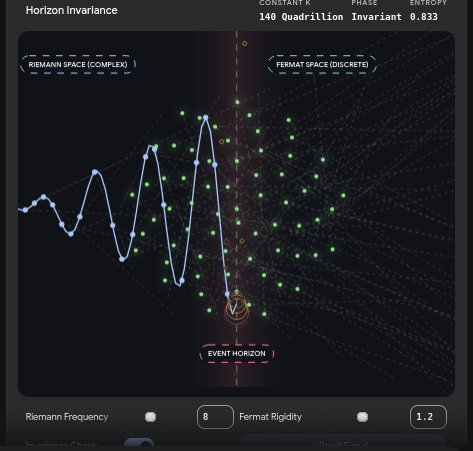
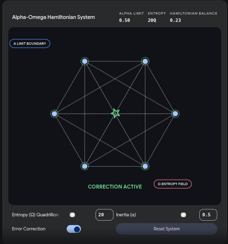
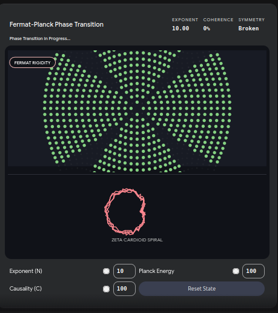
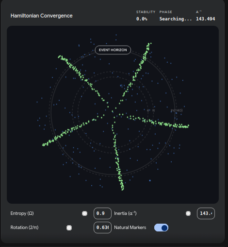
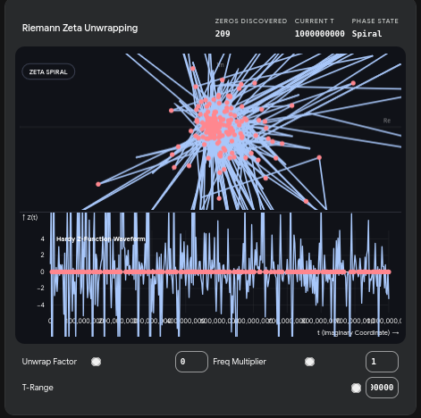
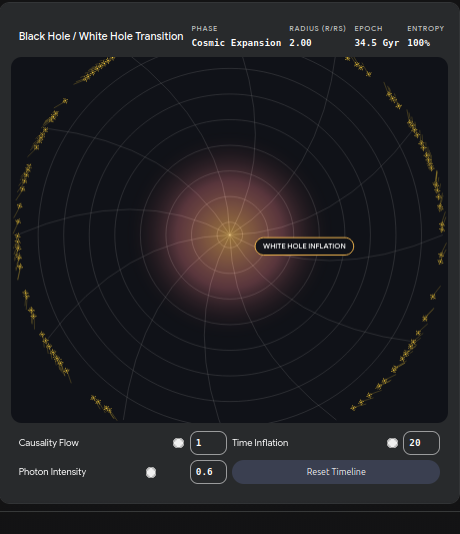

# 96 — The Riemann–Fermat Horizon

| | |
|---|---|
| Scope | the name "Horizon" for the σ = ½ fixed line; the standing-wave power identity at it; the Riemann–Fermat loop restated; where the First-Age Horizon experiment is documented and what its reproductions hold; the open pieces |
| Written | 2026-08-25. The author's naming correction, kept: "the Riemann-Fermat Horizon engine?" (replacing "Heartbeat") |
| Names the object of | [52c](52c_j2_involution_riemann_fermat.md) and the earlier "horizon = σ = ½" identifications ([01](01_overview.md), [03](03_inversion_engine.md), [15](15_the_monad.md), [26](26_TODO_and_roadmap.md), [29](29_witches_hat_paper.md), [30](30_lambda_paper.md), [31](31_cavitation_causality_fermat.md), `wiki/33`) |
| Records | `RiemannHypothesisProof/docs/`: `fermat_horizon_2026-11-12.md`, `omega_dstar_2026-11-11.md`, `four_dstar_2026-11-12.md`, `historic_sources_and_natural_crossings_2026-11-12.md`, `gemini_conversations_2026-11-12.md`, `nshape_shape_2026-11-10.md`; First Age `Ainulindale/AgeFirst/original_2026/ResearchPaper/` (`SMNNIP_Omega_Constant_Paper.txt`, `SMNNIP_Fermat_Proof_Attempt.txt`, `conjecture_proof.py`, `claude_to_gemini.txt`) |
| Confidence | the identities of §3 and the exceptional-prime table of §5: ESTABLISHED (re-run) · "Horizon" as the structure's name: a naming decision · the experiment's inertia half: **not reproducible as written** (no code; the constant it found is open, §5) |
| Last verified | 2026-11-13: Listing 1 executed; the RHP records were read (not re-run). **The fuller context for this page is being recovered by the author from earlier conversations (Gemini and claude.ai transcripts, several of them about seven months old); this page will be extended from those files and is not yet complete.** |

## 1. Why "Horizon", not "Heartbeat"

σ = ½ has been called the horizon in this project since wiki 29 (2026-06): "the brim, the event horizon, is the fixed point of the conformal inversion … corresponds to σ = ½ on the Riemann critical line" (29); "r = R_H (brim): V minimum, the zero crossing, σ = ½, the event horizon, the node" (30); "cos = sum; tan = where they balance = σ = ½ = event horizon = zero-divisor boundary" (26); and the same identification in 01, 03 (four physical horizons, Rindler,
Schwarzschild and others, all r = 1 fixed points of J_N), 15, 31 and 33. "Heartbeat" rested on [60](60_heart_j2_involution.md)'s literal-heart analogy, which that page's own corrections narrow. **Horizon names the structure: the σ = ½ fixed line, the N-shape crossing ([73](73_why_the_half_line.md) §4) where J_forward = J_backward. The standing wave is the behaviour at it, a pulse, not the boundary itself**, as Hawking pair-creation (in wiki 29's framing) is a process
at a fixed horizon, not the horizon. (The black-hole horizon itself is a coordinate feature; this page uses the word for the fixed line only, by structural analogy.)

## 2. The loop, restated  `INTERPRETATION`

```
Ĥ_RB = J_red + J_blue ;   Ĥ_RB − Ĥ_BR = J_red + J_blue = the loop current (the vortex, wiki 52b)
```

Fermat's forbidden zone (no aⁿ + bⁿ = cⁿ for n ≥ 3) carves a discrete structure; Riemann quantises it onto the complex plane; the zeros are the quanta; the zeros determine the prime distribution; the primes determine what the forbidden zone is: a self-consistent loop with no external input ([52c](52c_j2_involution_riemann_fermat.md) §5). The horizon is where the loop's two currents balance: σ = ½, where F = B and, by AM-GM, F + B is minimal
([61](61_up_down_not_forward_backward.md) Listing 1). **Open labelling conflict (ledger X-4, X-11):** this page, following wiki 52c, writes J_red = Fermat (discrete) and J_blue = Riemann (continuous); [14](14_redblue_hamiltonian.md) takes Red as the Berry–Keating "what is" operator and Blue as the Fermat–Weierstrass "what cannot be"; and the Tree labels differ again (wiki 47/104: Fermat = Blue = Telperion; the author's remark of
2026-11-10: "Fermat N-shape = Laurelin, Riemann N-holes = Telperion"). Which is canonical has not been settled, so none is imposed here.

## 3. The pulse at the horizon  `ESTABLISHED`, and elementary

**Listing 1 — the standing-wave identity** (written for this page; needs numpy; runs cold)

```python
import numpy as np, math
x = np.linspace(0, 2 * np.pi, 2000001)
print('integral of sin^2 over [0,2pi] = %.10f ; cos^2 = %.10f ; sin^2 = cos^2 = %.6f at pi/4' % (np.trapezoid(np.sin(x)**2, x), np.trapezoid(np.cos(x)**2, x), math.sin(math.pi / 4)**2))
```

```
integral of sin^2 over [0,2pi] = 3.1415926536 ; cos^2 = 3.1415926536 ; sin^2 = cos^2 = 0.500000 at pi/4
```

∫₀^{2π} sin²x dx = ∫₀^{2π} cos²x dx = π: the average power of a unit sinusoid over a cycle, and equal to the unit circle's area because sin² + cos² = 1 splits the period evenly into two π-halves. The crossing sin = cos is at phase π/4 (and π/4 + π), where sin² = cos² = ½: the resonance wiki 73's Engine 5 calls σ = ½ ([72](72_the_cosmic_telescope.md) §7; [73](73_why_the_half_line.md) §7). The page's statement "the horizon is where the standing wave's own energy splits
evenly between its two components; the pulse fires exactly at the crossing the rest of the project derived by five other, independent routes" needs one qualification from [73](73_why_the_half_line.md) §9: those routes are one local symmetry fact (σ ↔ 1 − σ with a conserved product) in different clothes, so the sin = cos crossing is the same crossing again, not independent evidence. The ∫ sin² = π identity is elementary and not unique to this system; what is specific to the project is where the crossing is placed.

## 4. What this is not claiming

- not that the σ = ½ horizon is a literal gravitational event horizon (the analogy is structural, as in 29/30/31/33, and is not strengthened here);
- not that the sin² integral is special to this system.

## 5. The Horizon experiment: what is recorded and what is reproduced

**As recorded** (First Age, 2026-04-09; the author's statements are quoted from the RHP records): a forward entropy ceiling meets an inverse floor at x = e^(−x), giving Ω = W(1) = 0.5671432904…; the "Hagedorn" start (the thermal ceiling, quoted variously as "140 quadrillion °F" in `conjecture_proof.py` and as 1.4×10¹⁷ K in the Second-Age text, against T_Planck = 1.4168×10³² K in the Ω paper, a scale discrepancy recorded in `fermat_horizon_2026-11-12.md`) was a way of working backward from the noise ceiling toward mathematics already mapped; the entropy chased is the
spacing and weighting of numbers; Ω and d\* were **post-hoc names for where two lines crossed**; the inertia half is "the same chase run on the Fermat side, from the speed of causality chasing inertia".

**Reproduced** (RHP records, `:CALCULATED`; not re-run on this pass): Ω reproduced blind by bisection on the two digit curves, with no Lambert W solved (`omega_dstar_2026-11-11.md`); d\*·ln 10 = Ω exactly (d\*_taut = −log₁₀ Ω, since ln Ω = −Ω), the independent hit being the measured d\*_spec = 0.24600 against 0.24631 ([17](17_alpha_omega_d_star.md)).

**Not reproducible:** the inertia half. `fermat_horizon_2026-11-12.md` finds text and no code ("the inertia chase cannot be reproduced as run: it was never written as an experiment. Nothing here derives α"). The author's rulings (2026-11-10, 2026-11-12, and 2026-11-13 of this overhaul): the fine-structure constant α_fs is **not** part of the Horizon mechanism (it was defined separately as a Lagrangian calibration, the same in every layer of the tower; structural constants sit outside the tower); **A_fermat is the constant found by the Fermat-side "chasing inertia" search**, distinct from α_fs and
from α_NN, its numeric value open; and 0_RB became visible *because of* the Horizon, so it is an after-the-fact check on what the two sides jointly say and not part of the reproduction. The Wyler (1971) formula α = (9/8π⁴)(π⁵/(2⁴·5!))^{1/4} = 1/137.0361 (about 6×10⁻⁷ from the measured value; numerology by most accounts) is the attribution older papers made for A_π and is not adopted ([134](134_the_library.md) §5; ledger X-5). The fine-structure-constant curve is being disambiguated by the
author separately; this page will absorb the result when it arrives.

**The N-shape** here means extending Fermat's triangles to N-dimensional shapes up the Cayley–Dickson tower and beyond (dimension generalisation, not only xˡ + yᵐ = zⁿ), describing a "continuous Laurelin" that leaves the primes as discrete holes; it may need rebuilding and needs the first version of the Inside-Out Inversion (the First-Age code is sporadic). **One object, two descriptions:** Riemann and Fermat describe the Prime Tree: Fermat by extinction (sieve/Möbius), Riemann by the zeta function; the zeta factorisation and the Möbius inverse carry the information, and
the stragglers matter in recursively sieving into an empty set where factors are born and primes remain holes (the author's statements, 2026-11-10).

**Listing 2 — the Fermat-side exceptional primes, by brute force** (written for this page; needs sympy; runs cold)

```python
from sympy import primerange
def exceptional(n, limit):
    out = []
    for p in primerange(2, limit):
        pw = {pow(x, n, p) for x in range(1, p)}
        if not any(((a + b) % p) in pw for a in pw for b in pw): out.append(p)
    return out
for n, lim in ((2, 60), (3, 120), (4, 200), (5, 400), (6, 600), (7, 1000)):
    print('n=%d: primes p < %d with no solution of x^n + y^n = z^n, xyz != 0 mod p:' % (n, lim), exceptional(n, lim))
```

```
n=2: primes p < 60 with no solution of x^n + y^n = z^n, xyz != 0 mod p: [2, 3, 5]
n=3: primes p < 120 with no solution of x^n + y^n = z^n, xyz != 0 mod p: [2, 7, 13]
n=4: primes p < 200 with no solution of x^n + y^n = z^n, xyz != 0 mod p: [2, 3, 5, 13, 17, 41]
n=5: primes p < 400 with no solution of x^n + y^n = z^n, xyz != 0 mod p: [2, 11, 41, 71, 101]
n=6: primes p < 600 with no solution of x^n + y^n = z^n, xyz != 0 mod p: [2, 3, 5, 7, 13, 19, 43, 61, 97, 157, 277]
n=7: primes p < 1000 with no solution of x^n + y^n = z^n, xyz != 0 mod p: [2, 29, 71, 113, 491]
```

These agree with the table of `fermat_horizon_2026-11-12.md` (n = 3: 2, 7, 13; n = 5: 2, 11, 41, 71, 101; n = 7: 2, 29, 71, 113, 491; n = 2: 3, 5; n = 4: 3, 5, 13, 17, 41; n = 6: 5, 7, 13, 19, 43, 61, 97, 157, 277), except that the brute-force lists also p = 2 for **every** n (x = y = z = 1 gives 1 + 1 ≡ 0 ≠ 1 mod 2, so there is no solution mod 2) and p = 3 for n = 6 (the sixth powers mod 3 are {1}, and 1 + 1 ≢ 1), which the record's table omits; the difference is in how the record treats the small primes dividing n or 2, to be
reconciled in the RHP source (logged as X-25). For prime n the exceptional primes are 2 and the primes ≡ 1 (mod n) that fail, a finite set certified complete below the Weil threshold in the RHP record (not re-run). This is the Fermat-side counterpart of "the places factorisation cannot reach": a finite set of primes unreached by the bulk of solutions, bounded by a ceiling.

### The pictures that came with it (Gemini simulators, 2026-04-11)

The April conversations ([136](136_the_origin_transcripts_2026_04.md)) produced a set of interactive simulators; thirteen screenshots survive and are in [`images/gemini_simulators/`](images/gemini_simulators/README.md) with a manifest. They are the visual origin of the Horizon vocabulary, and they show what the author was looking at when the names were chosen. They are pictures of an interface (settings and read-outs of demonstration code that was not kept), not measurements.

| | |
|---|---|
|  | **Horizon Invariance.** "Riemann space (complex)" to the left of a band marked "event horizon", "Fermat space (discrete)" to the right; sliders Riemann frequency 8 and Fermat rigidity 1.2; read-outs "constant K 140 Quadrillion", phase "Invariant", entropy 0.833. The K label is mis-scaled: the Planck temperature is 1.4×10³² K, not 1.4×10¹⁷ ([136](136_the_origin_transcripts_2026_04.md), ledger X-54). Two further frames: `yass2.png`, `yass3.png`. |
|  | **Alpha-Omega Hamiltonian System**, error correction on: six nodes in a regular hexagon, Hamiltonian balance 0.23 (10.47 with it off, `Gem_AO_Ham.png`). The "α" slider is labelled Inertia and the "Ω" slider Entropy, the pairing used in [17](17_alpha_omega_d_star.md). |
|  | **Fermat–Planck Phase Transition**: at exponent 10 the lattice is "Fermat rigidity", coherence 0 %, symmetry "Broken"; at exponent 2 (`Gem_FP1.png`) "Pythagorean fluidity", coherence 100 %, symmetry "Perfect"; below each, a "zeta cardioid spiral". The reading (exponent 2 admits integer solutions, exponent above 2 does not) is Fermat's last theorem used as a picture. |
|  | **Hamiltonian Convergence**: A⁻¹ read-out 143.494 against a slider "Inertia (α⁻¹)", rotation (2/π) 0.636, "Natural markers" on (`Gem_Ham_1.png`: 130.000). The α⁻¹ = 137.036 curve the author is having Gemini disambiguate is this slider's range; no flow equation is written beside it ([136](136_the_origin_transcripts_2026_04.md) §2). |
|  | **Riemann Zeta Unwrapping**: 209 zeros found at T = 10⁹, the zeta spiral above a Hardy Z waveform. |
|  | **Black Hole / White Hole Transition**: the cosmic-expansion frame (radius 2.00, epoch 34.5 Gyr, entropy 100 %); the collapsing frame is `Gem_BW.png`. **The Hairy Horizon** (`Gem_virus.png`): Noether flux 36.6, entropy 30 %, "systole" phase. |

## 6. Related pages

[52c](52c_j2_involution_riemann_fermat.md) · [73](73_why_the_half_line.md) · [60](60_heart_j2_involution.md) (the narrower heartbeat framing, kept as the literal-biology instance, corrected there) · [29](29_witches_hat_paper.md), [30](30_lambda_paper.md) (the horizon naming) · [17 α, Ω and d\*](17_alpha_omega_d_star.md) · [104](104_fermat_wiles_and_the_corollary_they_missed.md) · `VAPMIP/engines/e13_fermat_riemann_firing.py` (a different measurement, firing-order departure statistics, checked and ruled out as "the" heartbeat curve before the 2026-08-25 page was written)
